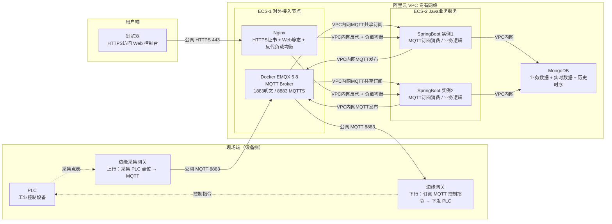

# 部署与网络架构

## 1. 整体数据流

整个系统的核心是 **MQTT 中枢** + **业务服务** + **MongoDB**，现场设备、Web 控制台、后台服务都围绕 MQTT 收发数据：

```
现场 PLC  ──►  边缘采集网关  ──►  MQTT Broker  ──►  服务器订阅消费  ──►  MongoDB 存储
                          ▲                          │
                          │                          ▼
                控制指令下发   ◄── 服务器发布 MQTT ◄──  Web 控制台
                          │
                          ▼
                      边缘网关  ──►  PLC  控制设备
```

> **关键链路**：所有数据（上行采集 + 下行控制）统一走 MQTT，单一协议、单一通道，便于接入鉴权与共享订阅。

## 2. 整体部署拓扑

整套系统部署在阿里云 VPC 专有网络内，由 2 台 ECS + 1 台 MongoDB 构成核心资源，EMQX 与 Nginx 共置于 ECS-1（公网接入节点），SpringBoot 业务服务部署于 ECS-2（内网隔离节点）。



## 3. 节点职责

### 3.1 现场端（设备侧）

| 设备 | 职责 | MQTT 角色 |
|------|------|----------|
| PLC | 工业控制设备，连接传感器/执行器 | 被采集对象 / 被控对象 |
| 边缘采集网关 | 定时轮询 PLC 寄存器，封装为 JSON 包上报 MQTT | **发布者**：`device/{sn}/data/upload` |
| 边缘网关 | 订阅 MQTT 控制指令，解析后下发到 PLC（写入寄存器/线圈） | **订阅者**：`device/{sn}/control/down` |

**说明**：
- **采集网关与控制网关可以是同一台物理设备**（如 USR-G780s 同时具备采集与边缘计算能力），但 Topic 严格区分上下行，避免回环
- 现场网关使用设备级证书（MQTT username/password）接入 EMQX，离线时本地缓存最近数据，恢复后补传

### 3.2 ECS-1（公网暴露节点）

| 组件 | 职责 |
|------|------|
| EMQX 5.8（Docker） | MQTT Broker，统一处理设备上行采集 + 下行控制指令，端口 1883 明文（仅内网）/ 8883 MQTTS（公网强制） |
| Nginx | 托管 React 前端静态页面，部署 HTTPS 证书；API 请求反向代理 + 负载均衡转发给 ECS-2 上的双 SpringBoot 实例 |

**安全组入方向仅放行**：`80`、`443`、`8883`
**EMQX 管理后台 18083**：禁止公网访问，仅内网可达

### 3.3 ECS-2（内网隔离节点）

| 组件 | 职责 |
|------|------|
| SpringBoot 实例1 | 业务服务：MQTT 订阅采集数据、死区过滤、数据校验、落库 MongoDB；接收 Web 控制指令后发布 MQTT 下发；提供 REST 接口 |
| SpringBoot 实例2 | 与实例1完全一致，无状态部署，配合 Nginx 实现负载均衡与故障转移 |

**关键约束**：
- ECS-2 **不开放任何公网入方向端口**，杜绝外网直接访问 Java 服务
- 所有接口只接受来自 ECS-1 内网的请求
- MQTT 业务数据流走 VPC 内网，不走公网，降低延迟、不计公网流量
- 两个实例通过 MQTT **共享订阅**（`$share/group/topic`）消费设备消息，避免重复处理
- **下行控制指令同样走共享订阅**，但需要 Redis/DB 分布式锁保证"同一指令只被一个实例下发一次"

### 3.4 数据库

| 组件 | 职责 |
|------|------|
| MongoDB | 业务数据存储（设备、点表、报警规则、通知人、用户账号）+ 点位实时数据 + 点位历史时序数据 |

**存储策略**：
- 点位历史数据设置 TTL 自动过期清理旧数据
- 死区过滤后再落库，减少写入压力
- 生产环境建议开启副本集保证数据可靠性

## 4. 对外入口

ECS-1 对外暴露以下入口，公网安全组收敛：

| 序号 | 入口 | 协议/端口 | 说明 |
|------|------|---------|------|
| 1 | Web 前端 | HTTPS 443 | 用户访问入口，React 静态页面 |
| 2 | Java API | HTTPS 443 | 统一 API 入口，经 Nginx 反代 + 负载均衡到 ECS-2 双实例 |
| 3 | MQTT 上行 | TCP 8883（公网强制 MQTTS） | 边缘采集网关上报采集数据 |
| 4 | MQTT 下行 | TCP 8883（公网强制 MQTTS） | 边缘网关接收控制指令 |

**域名规划**：
- `xxxx.com` — Web 前端 + API 统一入口
- `mqtt.xxxx.com` — MQTT 设备接入域名

## 5. 证书与域名

- 域名解析指向 ECS-1 公网 IP
- SSL 证书部署在 Nginx，网页 HTTPS 访问
- 可复用证书给 EMQX 开启 MQTTS 加密 PLC 通信
- 公网 MQTT 强制使用 8883 MQTTS 加密，禁止明文 1883 对公网开放

## 6. MQTT Topic 设计

所有数据统一走 MQTT，Topic 约定如下（`{sn}` = 设备序列号，`{cid}` = 采集通道/点位 ID）：

| 方向 | Topic | 发布方 | 订阅方 | QoS | 说明 |
|------|-------|--------|--------|-----|------|
| 上行 | `device/{sn}/data/upload` | 边缘采集网关 | 服务器（共享订阅 `$share/collector/...`） | 1 | 周期性采集数据，JSON：`{ts, points: [{id, value, quality}]}` |
| 上行 | `device/{sn}/event` | 边缘采集网关 | 服务器 | 1 | 事件上报：断电、故障、离线预警 |
| 上行 | `device/{sn}/data/reply` | 边缘采集网关 | 服务器 | 1 | 控制回执、指令执行结果 |
| 下行 | `device/{sn}/control/down` | 服务器（独占） | 边缘网关 | 1 | 控制指令下发：`{cmd_id, target: {cid, value}, expire}` |
| 下行 | `device/{sn}/config/down` | 服务器（独占） | 边缘网关 | 1 | 远程配置：采集周期、注册包、升级包 URL |
| 服务 | `server/broadcast` | 服务器 | 边缘网关 | 0 | 全局广播（如固件升级通知），允许丢弃 |

**关键规则**：
- 上行 Topic 用**共享订阅**让两个 SpringBoot 实例负载均衡；下行 Topic 必须**单实例发布**，订阅侧允许重复（边缘网关自身保证幂等）
- 所有上行 payload 携带 `sn` + `ts`，服务端按 `sn` 分库分表，按 `ts` 建立时序索引
- 下行指令携带 `cmd_id`（UUID），边缘网关 24h 内去重；服务端记录 `cmd_id → ack` 用于对账
- 设备凭据在 EMQX 侧绑定 ACL：`username = sn`，仅允许订阅/发布本设备自己的 Topic

## 7. Nginx 负载均衡配置要点

SpringBoot 单体部署两个实例，端口分别为 8081、8082，无状态，JWT Token 认证。

```nginx
upstream backend_iot {
    server 127.0.0.1:8081;  # ECS-2 内网IP:8081
    server 127.0.0.1:8082;  # ECS-2 内网IP:8082
}

server {
    listen 443 ssl;
    server_name xxxx.com;

    # SSL 证书配置
    ssl_certificate     /path/to/cert.pem;
    ssl_certificate_key /path/to/key.pem;

    # 前端静态资源
    location / {
        root /usr/share/nginx/react-dist;
        index index.html;
        try_files $uri $uri/ /index.html;
    }

    # API 反向代理 + 负载均衡
    location /api {
        proxy_pass http://backend_iot;
        proxy_set_header Host $host;
        proxy_set_header X-Real-IP $remote_addr;
        proxy_set_header X-Forwarded-For $proxy_add_x_forwarded_for;
    }
}
```

## 8. 安全关键点

| 项 | 配置 |
|----|------|
| ECS-1 入方向 | 443（HTTPS）、8883（MQTTS 上下行）、80（HTTP跳转） |
| ECS-1 出方向 | 仅放行 ECS-2、MongoDB、EMQX 内网 |
| ECS-2 入方向 | 仅允许 ECS-1 内网 |
| ECS-2 出方向 | 仅放行 MongoDB、EMQX 内网、第三方短信/微信 API |
| EMQX 18083 管理后台 | 仅内网访问，禁止公网暴露 |
| MQTT 公网接入 | 强制 8883 MQTTS 加密，禁用 1883 明文公网 |
| 设备鉴权 | MQTT username/password = 设备 SN + 平台下发密钥，离线吊销 |
| 下行指令幂等 | 指令携带唯一 `cmd_id`，边缘网关去重执行；服务端记录回执 |
| JWT 密钥 | 环境变量注入，不硬编码 |
| 双实例 MQTT 消费 | 共享订阅 `$share/group/topic`，避免重复消费 |
| 双实例下行 | 共享订阅消费控制指令 + Redis/DB 分布式锁，保证单发 |

## 9. 资源清单

| 组件 | 规格 | 职责 |
|------|------|------|
| ECS-1 | ecs.c7.large（2核4G） | EMQX MQTT + Nginx Web + HTTPS 证书 + 负载均衡 |
| ECS-2 | ecs.c7.large（2核4G） | SpringBoot 双实例业务服务（MQTT 消费、数据处理、REST 接口、定时归档任务） |
| MongoDB | 阿里云 MongoDB 版 副本集 2核4G / 100GB ESSD | 业务数据 + 3 个月热时序数据（按设备存原始包，约10-15GB） |
| OSS 对象存储 | 低频访问存储 | 超 3 个月冷数据快照归档，gzip 压缩存储，按需长期保留 |
| 域名 | 1 个 .com 域名 | 网页访问 + MQTT 接入入口解析 |
| SSL 证书 | 免费单域名证书 | Web HTTPS、MQTTS 加密 |
| VPC | 默认专有网络（免费） | ECS/MongoDB/OSS 内网互通 |
| 云监控 | 免费基础版 | ECS/MongoDB 状态监控与告警 |

> 基于 80 设备、每天 23 万条数据量，2核4G ECS 完全够用；如需留余量可升 ecs.g7.large（2核8G）。无需 4核8G。

### 9.1 MongoDB 部署方案（二选一）

| 方案 | 规格 | 优点 | 缺点 |
|------|------|------|------|
| **阿里云 MongoDB 版（推荐）** | 副本集 2核4G / 100GB ESSD | 免运维、自动备份、高可用、监控告警齐全 | 比自建略贵 |
| 自建 Docker MongoDB | 复用 ECS-2 或单独 2核4G ECS | 成本最低 | 自己管备份、主从、扩容 |

### 9.2 存储成本估算

| 数据层 | 数据量 | 存储介质 | 估算成本 |
|--------|-------|---------|---------|
| 热数据（3 个月） | ~10-15 GB（含索引，按设备存原始包） | MongoDB 100GB ESSD | 含在 MongoDB 实例费用中 |
| 冷数据（每月新增） | ~4 GB/月（压缩后约 0.5-1 GB） | OSS 低频访问存储 | 约 0.1 元/GB/月 |
| 冷数据累计（1 年） | 压缩后约 6-12 GB | OSS | 约 1-2 元/月 |

> 按设备存 500 字节原始数据包方案，3 个月热数据仅约 10-15 GB，100 GB 云盘完全够用；冷数据 gzip 压缩后体积约为原始数据的 10%-20%，OSS 存储成本极低。

### 9.3 月度总成本估算

| 资源 | 规格 | 估算月费 |
|------|------|---------|
| ECS-1 | 2核4G + 40GB系统盘 | ~120-150 元 |
| ECS-2 | 2核4G + 40GB系统盘 | ~120-150 元 |
| MongoDB 副本集 | 2核4G + 100GB | ~300-400 元 |
| OSS 低频存储 | ~12GB/年 + 流量 | ~5-10 元/月 |
| 域名 | .com | ~70 元/年（≈6元/月） |
| SSL 证书 | 免费 | 0 |
| VPC + 云监控 | 免费基础版 | 0 |
| **省心方案合计** | | **约 550-720 元/月** |
| **省钱方案合计**（自建MongoDB复用ECS-2） | | **约 250-320 元/月** |

> 省钱方案将 MongoDB 以 Docker 形式部署在 ECS-2 上，可省 300-400 元/月，但需自行运维备份与高可用。
